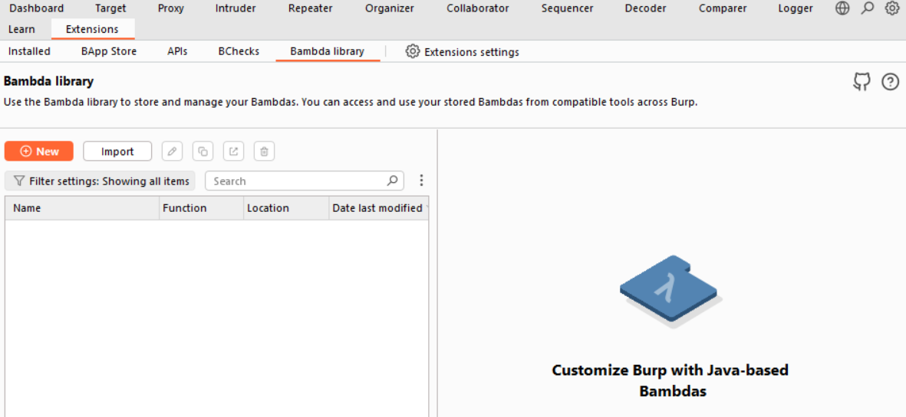
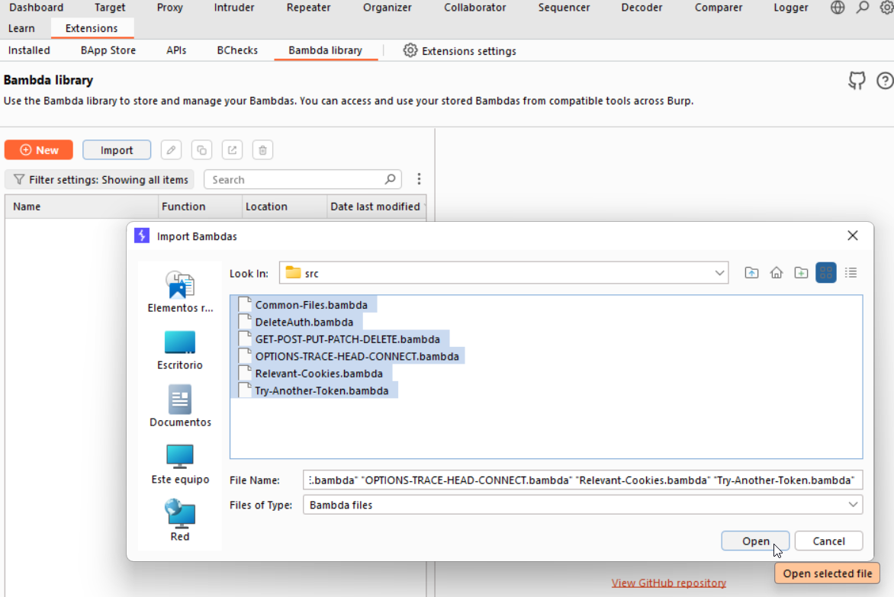
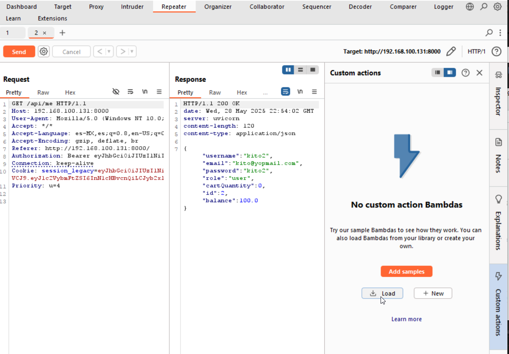
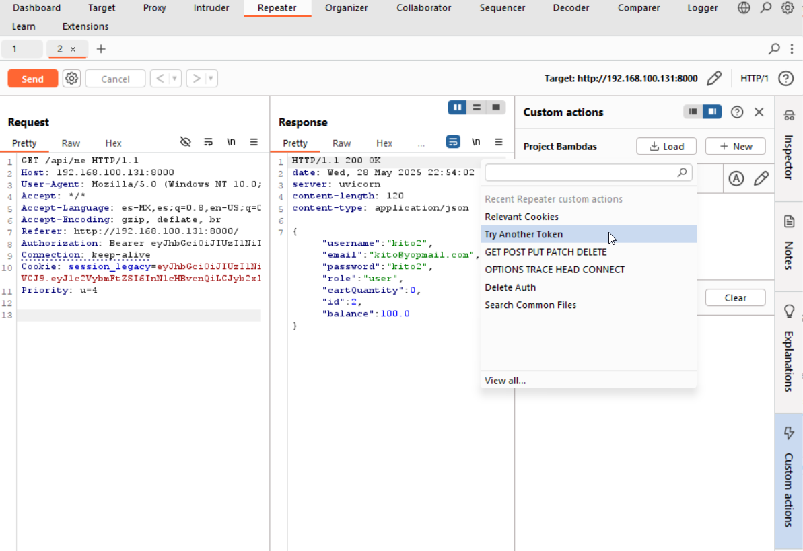
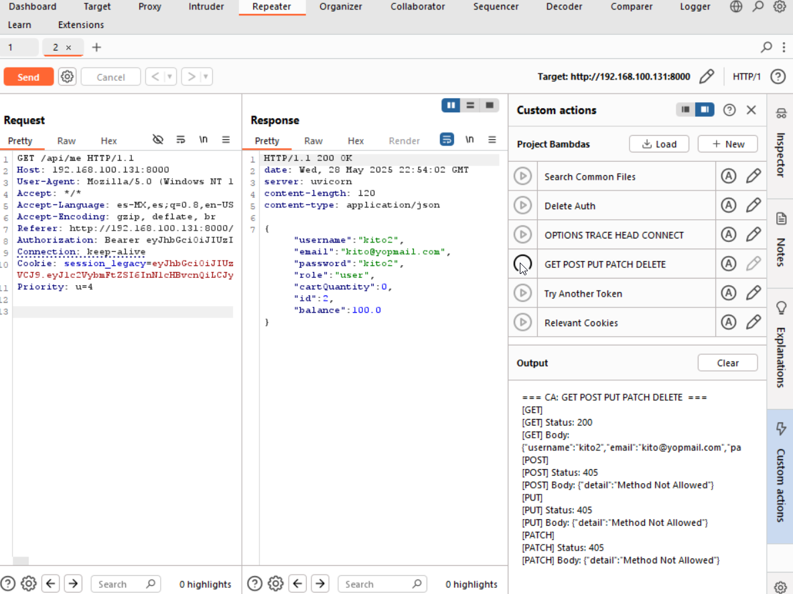
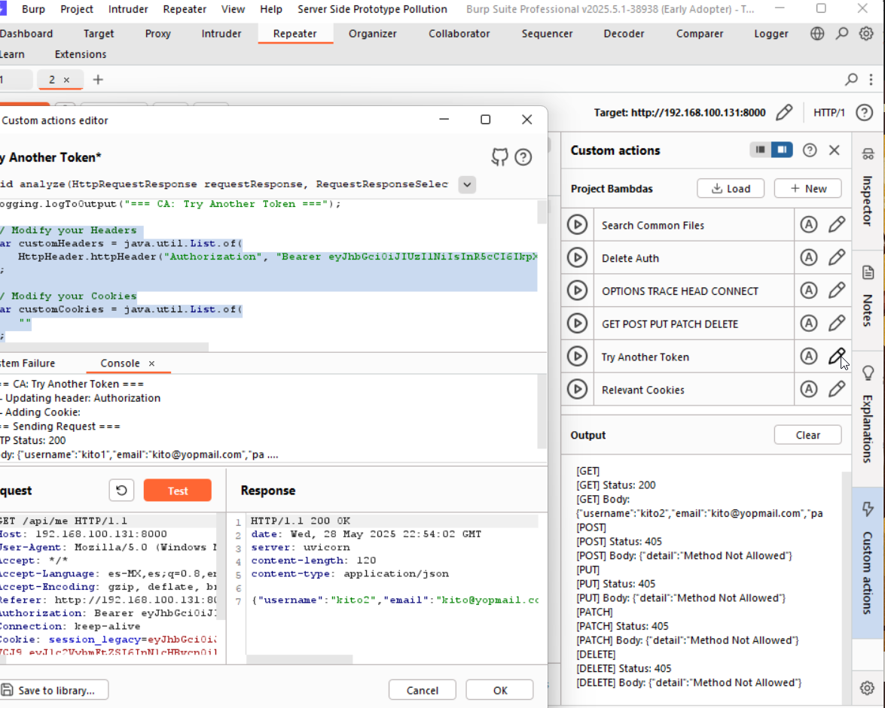

# BurpSuite - Acciones Personalizadas (Custom Actions)

Este repositorio contiene un recopilado de las Custom Actions de BurpSuite que he desarrollado para hacer más eficiente ataques de suplantación de tokens de sesión, uso anónimo, uso de peticiones no documentadas y verificación de archivos comunes.

## Descripción de Scripts 

- **Common-Files.bambda**: Busca archivos comunes dentro del directorio de la petición actual. `/app/index.html?x=1` y `/app/` buscan `/app/robots.txt`, etc.; `/app` busca en el directorio raíz. Se omite la query original y el control de ruta inexistente utiliza el mismo directorio.
- **Relevant-Cookies.bambda**: Prueba eliminar cookies y luego cambia el valor de las conservadas por `a` (`b` si ya era `a`). Distingue cookies prescindibles, sustitución aceptada, sensibles al valor e inconclusas. Valida y exporta la petición reducida con los valores de sustitución aceptados a una nueva pestaña de Repeater.
- **Try-Another-Token.bambda**: Reenvía la petición actual con el token de sesión de otro usuario, modificando únicamente la cabecera o cookie especificada. Útil para probar suplantación de identidad.
- **Multi-Auth-Profiles.bambda**: Envía la petición original una vez por perfil de autenticación. Cada perfil combina cualquier número de headers y cookies, con credenciales independientes. Muestra estado, bytes del cuerpo y una vista previa breve en Output.
- **Selected-String-Analyzer.bambda**: Comprueba Base64 mediante decodificación, datos binarios y Luhn. Superar Luhn no demuestra que una tarjeta exista. Para hashes utiliza Hash Identifier.
- **DeleteAuth.bambda**: Conserva las cabeceras esenciales de destino y del cuerpo (incluidas Host y Content-Type), elimina las demás cabeceras y todas las cookies, y mantiene método, URL y cuerpo binario originales.
- ⚠️ **GET-POST-PUT-PATCH-DELETE.bambda**: Ejecuta la solicitud con distintos métodos HTTP para descubrir funcionalidades expuestas.  
  ⚠️ **Advertencia**: El uso del método DELETE podría causar cambios irreversibles.
- **OPTIONS-TRACE-HEAD-CONNECT.bambda**: Prueba métodos HTTP menos comunes para descubrir superficies adicionales de ataque.
- **Relevant-Headers.bambda**: Prueba eliminar cabeceras no esenciales y cookies; después sustituye las necesarias por `a` (`b` si ya era `a`) para distinguir requisitos de presencia y sensibilidad al valor. Conserva las cabeceras protegidas y exporta la petición reducida validada, con las sustituciones aceptadas, a una nueva pestaña de Repeater.
- **HashIdentifier.bambda**: Reconoce formatos compatibles con MD5, SHA-1, SHA-256, SHA-512 y bcrypt; el formato no confirma el algoritmo.
- **Request-Smuggling-Tester.bambda**: Genera y envía cuatro sondas base (CL.TE, TE.CL, H2.CL y H2.TE) para inspeccionarlas en Logger y continuar las pruebas manualmente. Output identifica cada variante y muestra estado de respuesta, tamaño del cuerpo y duración, o errores de transporte.
- **Web-Cache-Deception.bambda**: Prueba extensiones estáticas y variantes de normalización de directorios y nombres de archivo, con controles anónimos antes y después de cargar la respuesta autenticada. Informa exposición repetida de contenido privado y evidencia de caché sin descartar respuestas con Cache-Control restrictivo. No confirma automáticamente una vulnerabilidad.

## Validación y límites

### Múltiples perfiles de autenticación

Importa `src/Multi-Auth-Profiles.bambda` y edita su configuración dentro de Burp:

1. Sustituye las credenciales de ejemplo en `profiles`. Añade tantos elementos `new AuthProfile(nombre, headers, cookies)` como necesites. Cada elemento envía una petición; los perfiles no se combinan entre sí.
2. Usa `java.util.Map.of("Nombre-Header", "valor", "Otro-Header", "valor")` para headers y `java.util.Map.of("nombreCookie", "valor")` para cookies. Un mapa vacío se escribe `java.util.Map.of()`. Introduce únicamente el valor de cada cookie, sin su nombre ni el prefijo `Cookie:`; los valores con `=` se conservan. Para más de diez entradas usa `Map.ofEntries(Map.entry(...), ...)` con los nombres completos `java.util.Map`.
3. Añade a `credentialHeaders`, en minúsculas, los nombres de otras cabeceras de credenciales originales. Antes de aplicar cada perfil se eliminan todas las cookies originales y todas las instancias de las cabeceras configuradas o utilizadas por los perfiles. Se conservan las demás cabeceras, método, ruta, query y cuerpo binario.
4. Cambia `configured = true` después de sustituir los ejemplos. Los resultados aparecen en Output; la acción no crea pestañas de Repeater. Consulta Logger para ver los intercambios completos.

Ejemplo de perfil combinado:

```java
new AuthProfile("Usuario A", java.util.Map.of(
    "Authorization", "Bearer TOKEN_USUARIO_A",
    "X-CSRF-Token", "CSRF_USUARIO_A"
), java.util.Map.of(
    "session", "SESION_USUARIO_A",
    "csrf", "CSRF_USUARIO_A"
))
```

Para un perfil anónimo utiliza dos mapas vacíos. Un fallo en un perfil no interrumpe los siguientes. Output muestra `[Nombre del perfil] status=200 | bytes=264659`, seguido de una vista previa del cuerpo de hasta 50 caracteres (más `...` si se trunca). Los saltos de línea y tabulaciones se sustituyen por espacios; los cuerpos vacíos se indican con `(empty)`. Los estados y tamaños son observaciones, no prueban un fallo de autorización. No incluyas secretos en los nombres de perfiles.

Los perfiles configuran autenticación mediante headers/cookies. Elimina aparte las credenciales de la query o del cuerpo original y desactiva reglas de sesión o extensiones que reintroduzcan credenciales. Cada ejecución repite la operación original N veces, incluidos sus efectos en el servidor. Incluye explícitamente en cada perfil todas las cookies necesarias, incluso las que no sean de autenticación.

Las acciones Relevant requieren dos respuestas base estables. Puedes configurar `volatilePattern` para campos dinámicos conocidos; usa patrones específicos para no ocultar diferencias relevantes. Las eliminaciones son acumulativas y la petición final se valida de nuevo; no se garantiza el mínimo global. Conservan el cuerpo original sin convertirlo a texto.

Relevant Cookies compara estado HTTP, Content-Type, Location y cuerpo normalizado. Si eliminar una cookie cambia la respuesta, su presencia es necesaria en esa reducción; si sustituir su valor mantiene la respuesta base, la petición exportada usa ese valor sustituto. Si la sustitución altera la respuesta, se clasifica como sensible al valor, sin demostrar validación segura. Aceptar `a` no demuestra que cualquier valor sea aceptado. Los nombres duplicados se prueban como grupo y primero se comprueba que unificar las cabeceras Cookie no cambie la respuesta. Los fallos de transporte conservan los valores previos y se consideran inconclusos. Desactiva reglas de sesión/extensiones que restauren cookies. Las demás cabeceras de autenticación se conservan, por lo que el resultado corresponde al contexto de la petición actual.

Relevant Headers aplica las mismas pruebas de eliminación y sustitución a cabeceras no esenciales y después a cada nombre de cookie. Agrupa las cabeceras duplicadas sin distinguir mayúsculas y las cookies duplicadas respetando mayúsculas. Conserva `protectedNames`, incluidas Host, Content-Type, Content-Encoding y cabeceras de protocolo/longitud; Cookie se analiza por separado. Output distingue Header y Cookie y resume elementos eliminados, sustituciones aceptadas, sensibles al valor e inconclusos. Los cambios aceptados se acumulan; la petición final y el control original deben coincidir con la respuesta base antes de exportar a `Relevant Headers - reduced`. Se aplican los mismos límites de interpretación que en Relevant Cookies.

Web Cache Deception requiere GET y conserva los parámetros originales de la query. La configuración predeterminada prueba 53 variantes: 42 combinaciones de delimitadores/extensiones, nueve variantes de normalización de directorios y dos de nombres de archivo. Adapta `staticDirectories` y `staticFiles` al objetivo. Son rutas exploratorias, no demuestran que la caché o el origen las normalicen como se espera. Output identifica cada variante; los intercambios completos quedan en Logger y no se crean pestañas de Repeater.

Cada variante se solicita anónimamente antes de cargarla con autenticación y después se recupera dos veces sin credenciales. Las secuencias positivas se contrastan con una ruta equivalente nueva sin cargar y una respuesta base autenticada reciente. El contenido accesible antes de la carga se informa aparte; coincidencias en la ruta equivalente, controles inestables y errores de transporte se consideran inconclusos. El control anónimo previo puede almacenar un rechazo: si la carga autenticada no reproduce la respuesta base, se reintenta una vez en una URL nueva cargándola primero con autenticación e indicando que la atribución es menos sólida. El procesamiento puede enviar hasta siete peticiones por variante más tres controles iniciales. No encontrar candidatos no descarta deception.

Configura `volatilePattern` para normalizar campos dinámicos específicos. Como alternativa, usa `sensitivePattern` con una expresión que identifique contenido privado propio del usuario: se compara el primer grupo de captura (o la coincidencia completa si no hay grupos), en orden de aparición, además de estado, Content-Type y Location. Una coincidencia ausente o vacía en la respuesta base es inconclusa; los patrones demasiado amplios pueden producir falsos positivos. Con ambos patrones vacíos se exige igualdad del cuerpo completo. Si se configura `sensitivePattern`, tiene prioridad sobre `volatilePattern`.

La acción registra Cache-Control en lugar de excluir respuestas `private`, `no-store` o `no-cache`: una caché compartida mal configurada puede ignorar restricciones y `no-cache` permite almacenamiento con revalidación. Age positivo o señales HIT en X-Cache, CF-Cache-Status, X-Cache-Status o Cache-Status aportan evidencia adicional, sin confirmar el hallazgo. Los candidatos requieren validar manualmente el origen en caché compartida y su persistencia.

Amplía `credentialHeaders` con todas las cabeceras de credenciales de la aplicación. Por defecto elimina todas las instancias de Authorization, Proxy-Authorization, Cookie, X-Api-Key, Api-Key, X-Auth-Token, X-Access-Token, X-CSRF-Token y X-XSRF-Token, sin distinguir mayúsculas. Se conservan credenciales de query/cuerpo: elimínalas aparte y desactiva reglas de sesión/extensiones que reintroduzcan credenciales. Por defecto, `removeCacheBypassHeaders` elimina Cache-Control, Pragma y cabeceras condicionales y Range de las peticiones antes de todas las pruebas. `addCacheBuster` añade un parámetro único `__wcd` conservando los parámetros originales; si se desactiva, se omiten las variantes de nombres de archivo. Las rutas y parámetros únicos no garantizan aislamiento de caché, especialmente tras normalización o si la query no forma parte de su clave. Estas pruebas pueden dejar contenido privado en una caché compartida; utiliza una cuenta y un entorno de pruebas controlados.

Request Smuggling Tester proporciona peticiones iniciales para investigación manual, sin detectar vulnerabilidades automáticamente. Ejecútalo, inspecciona los cuatro intercambios en Logger y adapta las sondas al objetivo. Las sondas HTTP/1 utilizan discrepancias entre Content-Length y Transfer-Encoding; las de HTTP/2 prueban el comportamiento durante la conversión a HTTP/1. Esa conversión puede normalizar o rechazar las anomalías previstas, por lo que debes revisar la representación enviada. Las peticiones internas `/KITO` son prefijos incompletos intencionadamente para pruebas posteriores. Las sondas conservan el servicio y la ruta originales, pero reconstruyen las cabeceras y el cuerpo sin la autenticación original. Las diferencias de estado, demoras y errores de transporte no confirman ni descartan smuggling por sí solos; valida el comportamiento en un entorno de pruebas aislado.

Estas acciones reenvían peticiones: Relevant puede repetir operaciones con efectos secundarios. Los errores de transporte no equivalen a vulnerabilidades. La compatibilidad final debe verificarse importando las acciones en tu versión de Burp.

Las variantes GET/POST/PUT/PATCH/DELETE conservan el cuerpo original; CONNECT utiliza una petición HTTP/1 con destino host:puerto, sin las cabeceras ni el cuerpo del recurso original. Common Files excluye respuestas idénticas a un control con ruta aleatoria inexistente, aunque las páginas comodín dinámicas pueden seguir produciendo candidatos falsos. Delete Auth conserva únicamente la lista configurable essentialHeaders, sin distinguir mayúsculas: Host, Content-Type, Content-Length, Transfer-Encoding, Content-Encoding, Connection, TE, Trailer, Expect y pseudocabeceras HTTP/2. Elimina las demás cabeceras y todas las cookies. Las credenciales de query/cuerpo se conservan y las reglas de sesión pueden restaurar autenticación; consulta Logger para ver la petición enviada.

## Instalación

1. Clona el repositorio de github.
```bash
   git clone https://github.com/marco14850/burp-custom-actions.git
```

2. Abre BurpSuite y ve a: Extensions > Bambda Library.
<p align="center">
  
</p>

3. Haz clic en el botón Import y selecciona todos los archivos en la carpeta /src.
<p align="center">
  
</p>

4. Luego en la pestaña Repeater, ve a Custom Actions > Load y selecciona los archivos de acciones personalizadas.
<p align="center">
  
</p>
<p align="center">
  
</p>

5. Ejecuta las acciones personalizadas desde cualquier solicitud cargada en Repeater.
<p align="center">
  
</p>

6. Si necesitas personalizar valores (como en el script 'Try Another Token'), edita el script directamente desde BurpSuite y reemplaza el token o cookie deseado.
<p align="center">
  
</p>
